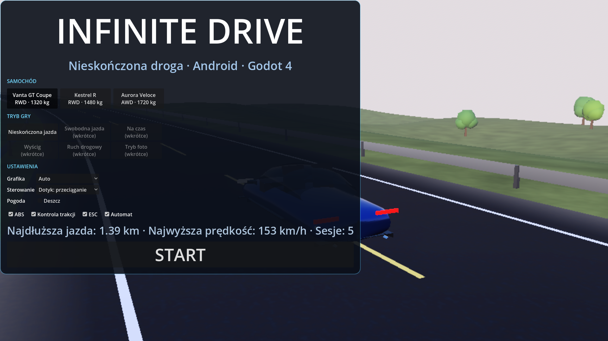
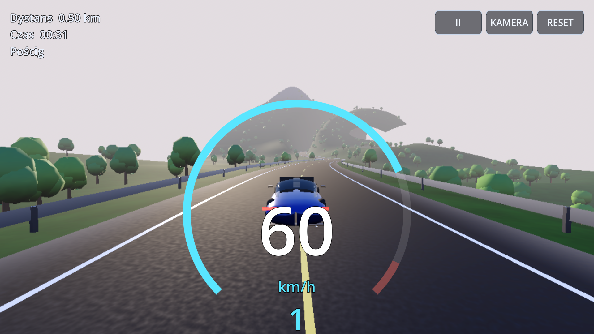
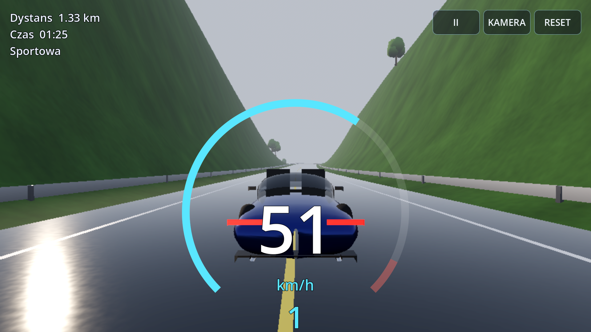
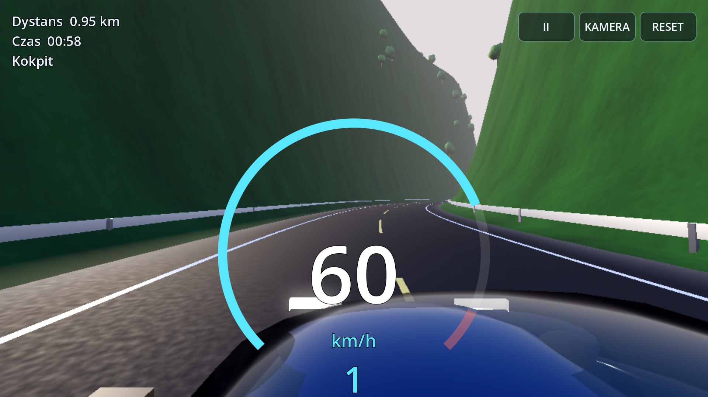
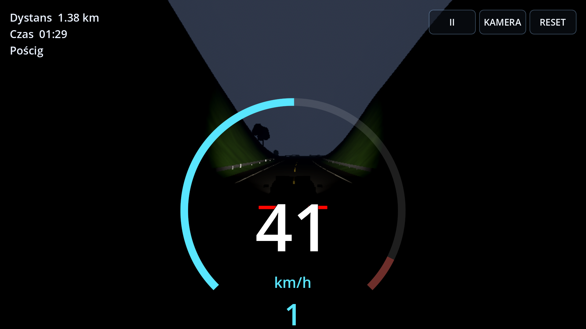
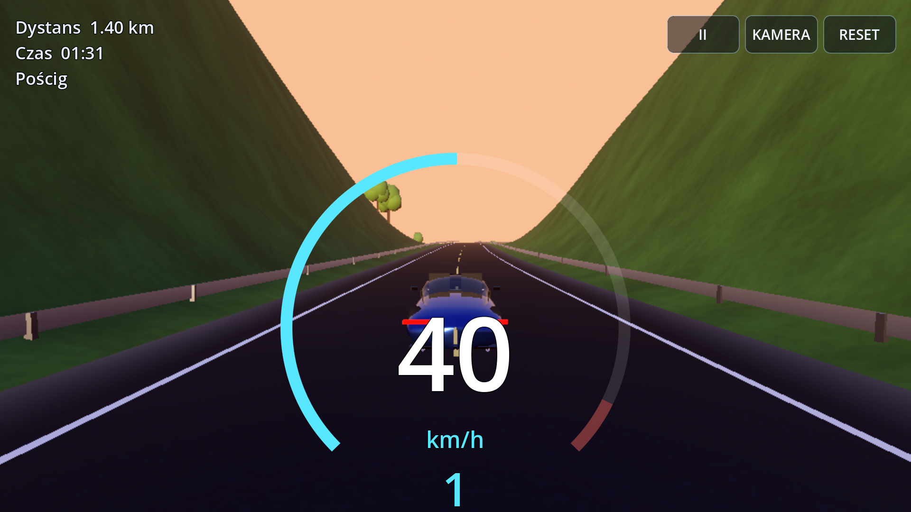

# Infinite Drive — proceduralna gra wyścigowa na Androida (Godot 4)

Gra wyścigowa 3D w **Godot 4.6.1 / GDScript**, eksportowana jako APK arm64 dla Androida.
Rdzeń: nieskończona, deterministyczna, proceduralna droga asfaltowa, własna fizyka pojazdu
oparta na `RigidBody3D` (zawieszenie, opony Pacejki, napęd, hamulce, ABS/TC/ESC) oraz
strumieniowanie świata wokół samochodu.

## Status (stan na ten commit)

| Etap | Zakres | Stan |
|---|---|---|
| **A — grywalny fundament** | samochód, fizyka, kamery, sterowanie dotykowe, asfaltowa droga, generator, HUD, APK | **zrealizowany** i zweryfikowany testami headless, testem wizualnym pod Xvfb oraz strukturą APK |
| B — nieskończony świat | tunele, mosty, wyraźne biomy, morze, serpentyny | nie zrealizowane |
| C — jakość graficzna | modele LOD, tekstury PBR z zasobów, impostory, odbicia | nie zrealizowane (obecnie proceduralne prototypy) |
| D — zaawansowana symulacja | pełny mechanizm różnicowy, zaawansowana elektronika, tory momentu | częściowo (model podstawowy) |
| E — pełna rozgrywka | garaż, ruch drogowy, tryby inne niż Endless, dźwięk, personalizacja | nie zrealizowane (poza silnikiem dźwięku i zapisem postępu) |
| F — optymalizacja i wydanie | profilowanie na urządzeniu, profile jakości na sprzęcie | adaptacyjna rozdzielczość zaimplementowana, **niezmierzona na urządzeniu** |

### Czego NIE zweryfikowano (jawnie)

- **Nie uruchomiono APK na urządzeniu ani emulatorze.** Nie ma Galaxy Z Fold 8 Ultra ani emulatora w tym środowisku. APK jest zbudowany i sprawdzony narzędziami SDK (podpis, `zipalign`, manifest, biblioteka arm64), ale nie testowano instalacji, uruchomienia ani sterowania dotykowego na Androidzie.
- **Brak pomiarów FPS** na urządzeniu. Nie podajemy liczb wydajności dla Fold 8. Pomiary są tylko z hosta (CPU, programowe renderowanie Mesa llvmpipe).
- **Workflow GitHub Actions nie był uruchamiany** (nie ma dostępu do Actions z tego środowiska). Skrypt `scripts/build_android.sh` został uruchomiony lokalnie od początku do końca.
- **Release (podpisany AAB) nie był budowany** — brak keystore. Preset i ścieżka są skonfigurowane, ale nieprzetestowane.
- Zrzuty ekranu pochodzą z renderowania programowego (Mesa llvmpipe w Xvfb), a nie z GPU telefonu.

## Ograniczenia i niezaimplementowane funkcje

Wymienione zgodnie z zasadą „nie oznaczaj nieukończonych funkcji jako ukończonych”:

- **Świat:** brak tuneli, mostów i wiaduktów; droga ma stały promień minimalny 80 m (brak ciasnych serpentyn); brak morza, wybrzeży, miast, wsi, zimy i pustyni jako osobnych biomów (są tylko proceduralne strefy lasu, otwartego terenu, suchego terenu i skał/śniegu na wysokości).
- **Teren poza pasem ±125 m** nie jest modelowany — horyzont to mgła. Brak dalekiego LOD i impostorów.
- **Drzewa** to proceduralne prototypy (kule z szumem), bez kolizji — samochód przez nie przenika, jeśli zjedzie z drogi. Brak pulowania obiektów poza węzłami segmentów.
- **Modele aut** są proceduralne (karoseria z superelipsy, szyby, wnętrze, felgi, opony z bieżnikiem). Brak tekstur PBR, map normalnych i wielu poziomów LOD. Nie używano Blendera (nie jest zainstalowany).
- **Fizyka:** uproszczony model Pacejki z elipsą tarcia, bez relaksacji opony; ESC to tłumienie odchylenia (brak torque vectoringu); napęd z otwartym dyferencjałem; brak precyzyjnej charakterystyki silnika poza krzywą momentu. Tryby „Arcade/Sport/Simulation” nie są wyodrębnione.
- **Pogoda:** tylko deszcz (mokra nawierzchnia, spadek przyczepności, cząsteczki). Brak mgły jako osobnego stanu, burz i śniegu. Pora dnia jest ustawiana w kodzie (domyślnie 16:48), bez cyklu i bez opcji w menu.
- **Noc:** reflektory samochodu i oświetlenie nieba; brak latarni wzdłuż drogi.
- **Tryby gry:** działa tylko **Nieskończona jazda (Endless Drive)**. Pozostałe tryby są widoczne w menu jako „wkrótce” i wyłączone.
- **Kamery:** 7 trybów (pościg, sportowa, kokpit, nad maską, zderzak, filmowa, swobodna). Brak zdjęć i zapisu fotografii.
- **Sterowanie:** dotyk (przeciąganie + pedały), akcelerometr, klawiatura i pad. Kierownica i pedały dotykowe mają ustawienia czułości. Brak regulacji wielkości przycisków i przesuwania interfejsu.
- **Audio:** tylko syntezowany dźwięk silnika (bez turbo, opon, wiatru, tuneli).
- **Garaż, zapis konfiguracji aut, ruch drogowy (AI), wyścigi przeciwników:** nie zaimplementowane.
- **Zapis:** zapisywane są ustawienia, rekordy i sumy przejechanych kilometrów. Stan jazdy nie jest zapisywany w trakcie sesji (tylko punkty kontrolne co 30 s, pauza i przełączenie aplikacji).
- **Rozdzielczość:** dynamiczna skala renderu (tryb Auto) i profile Performance/Balanced/High/Ultra. Nie zweryfikowano na sprzęcie, czy 60 FPS jest osiągalne na Foldzie.
- **Składane ekrany:** układ używa proporcji viewportu i marginesów bezpiecznego obszaru, ale nie testowano zmiany rozmiaru na żywym urządzeniu.

## Jak zbudować

Wymagania na hoście: Linux x86_64, JDK 17+ (w tym środowisku JDK 21), Android SDK z `platforms;android-36`, `build-tools;36.0.0` i `platform-tools`, `curl`, `unzip`, `keytool`.

```bash
scripts/build_android.sh                       # testy + APK debug w build/
SKIP_TESTS=1 scripts/build_android.sh          # tylko APK
GODOT_BIN=/ścieżka/do/godot scripts/build_android.sh   # użyj własnego Godota 4.6.1
BUILD_TYPE=release scripts/build_android.sh    # podpisany AAB (wymaga zmiennych poniżej)
```

Skrypt bez edytora Godot: pobiera Godota 4.6.1 i szablony eksportu (jeśli brak), konfiguruje SDK i JDK w
ustawieniach edytora, tworzy lokalny keystore debug poza repozytorium (`~/.android/debug.keystore`),
importuje projekt, uruchamia testy, eksportuje APK (`--export-debug`) i weryfikuje go (`aapt2`, `zipalign`,
`apksigner`, obecność `lib/arm64-v8a/libgodot_android.so`).

Dla release: `GODOT_ANDROID_KEYSTORE_RELEASE_PATH`, `GODOT_ANDROID_KEYSTORE_RELEASE_USER`,
`GODOT_ANDROID_KEYSTORE_RELEASE_PASSWORD`. Hasła nigdy nie są zapisywane w repozytorium.

### CI (GitHub Actions)

`.github/workflows/android.yml` buduje APK przy każdym pushu i publikuje go jako artefakt
`InfiniteDrive-debug-apk`. Ręczne uruchomienie z `build_type=release` tworzy podpisany AAB, gdy ustawiono
sekrety `ANDROID_RELEASE_KEYSTORE_B64`, `ANDROID_RELEASE_KEY_ALIAS` i `ANDROID_RELEASE_KEYSTORE_PASSWORD`.
Workflow nie był uruchamiany (patrz wyżej).

## Testy

```bash
godot --headless --path game -s res://testing/run_tests.gd          # 27 sprawdzeń, kod wyjścia 0/1
xvfb-run -a godot --path game --rendering-method gl_compatibility \
  -s res://testing/visual_check.gd -- docs/screenshots               # zrzuty ekranu prawdziwej sceny
```

Wynik ostatniego pełnego uruchomienia (`scripts/build_android.sh`, ten commit): **27 passed, 0 failed**.

| Obszar | Sprawdzenie | Wynik |
|---|---|---|
| Kompilacja | wszystkie 31 skryptów GDScript się ładują | OK |
| Szum | zakres, determinizm, zależność od ziarna | OK |
| Droga | powtarzalność z ziarna, także przy cofaniu do wcześniejszych segmentów | identyczna (różnica 0) |
| Droga | równe odstępy próbek; całkowanie kąta = krzywizna·ds | błąd 9e-6 m; 2e-7 rad |
| Droga | promień min., spadek max., ciągłość krzywizny, szwy segmentów | 1/113 m (limit 1/80); 6.35 %; szwy 4e-6 m |
| Droga | 1000 km (10 000 segmentów) bez NaN, limity zachowane | 5.5 s; min. promień 98 m; spadek 6.85 % |
| Teren | teren zbiega się z poziomem asfaltu, daleko wraca do naturalnego | OK |
| Segmenty | drogi, teren i drzewa; ten sam wynik dla tego samego wejścia | 600 tr. drogi, 2600 tr. terenu, ~39 ms/segment |
| Zapis | round-trip JSON; uszkodzone dane wracają do domyślnych | OK |
| Opony | szczyty modelu Pacejki = 1, elipsa tarcia | 1.000 / 0.990 |
| Streaming | segmenty przed autem, zwalnianie za nim, przesunięcie początku układu | OK; 1500.000 m |
| Rzutowanie | odległość boczna i kierunek drogi | 2.99 m; błąd kierunku 0 |
| Fizyka | 0–100 km/h Kestrel R | **5.24 s**, 300 km/h osiągalne |
| Fizyka | hamowanie 100→0 km/h z ABS (Vanta GT) | **41.5 m** |
| Fizyka | skręt 60 km/h (Aurora AWD) | przyczepność **0.85 g**, bez przewrócenia |
| Fizyka | niezależność od częstotliwości: 120 Hz vs 60 Hz | różnica **0.2 %** |
| Fizyka | postój na zboczu 5° z hamulcem | dryf **0.02 m** / 4 s |
| Fizyka | zderzenie ze ścianą | zatrzymanie, brak przenikania |
| End-to-end | autopilot jedzie 40 s po wygenerowanej drodze | 642 m, odchylenie max **0.36 m**, 60 km/h |

Autopilot (`testing/road_autopilot.gd`) służy tylko do testów i nie jest częścią gry.

## Sterowanie

- **Dotyk:** lewa połowa ekranu — przeciągnij w lewo/prawo (kierownica, samocentrowanie po puszczeniu).
  Prawa dolna część — pedał **HAMULEC** (lewy) i **GAZ** (prawy); wysokość palca w strefie pedału = siła.
  Przyciski u góry: pauza (II), zmiana kamery, reset auta na drodze; w trybie ręcznym „+” i „−”.
- **Klawiatura:** A/D lub strzałki — skręt; W/↑ gaz; S/↓ hamulec; Spacja — ręczny; C — kamera; R — reset;
  E/Q — bieg w górę/w dół (tryb ręczny); Esc/P — pauza.
- **Pad:** lewa gałka — skręt; RT/LT — gaz/hamulec; A — ręczny; Y — kamera; X — reset; RB/LB — biegi; Start — pauza.
- **Akcelerometr:** w ustawieniach „Akcelerometr” lub „Dotyk + akcelerometr”.

## Architektura

Moduły odpowiadają podziałowi ze specyfikacji (katalogi w `game/`):

| Katalog | Zawartość |
|---|---|
| `core/` | stałe (`GameConfig`), deterministyczny szum (`HashNoise`), generator drogi (`RoadPath`) |
| `proceduralroad/` | segment drogi (`RoadChunk`), budowanie geometrii segmentu (`RoadChunkBuilder`) |
| `terrain/`, `biomes/` | pole wysokości blendowane do asfaltu (`TerrainField`), biomy (`BiomeSampler`), drzewa (`TreeLibrary`) |
| `worldstreaming/` | streamer segmentów, budowanie na `WorkerThreadPool`, przesunięcie początku (`WorldStreamer`) |
| `vehicle/` | kontroler pojazdu (`VehicleController`), katalog aut (`CarCatalog`), model proceduralny (`CarModelBuilder`) |
| `physics/` | model opony Pacejki (`TireModel`), silnik i skrzynia (`EngineModel`) |
| `cameras/` | kamera z 7 trybami i kolizją z geometrią (`CameraRig`) |
| `input/` | zunifikowane wejście (`DriverInput`) i nakładka dotykowa (`TouchOverlay`) |
| `environment/`, `rendering/` | niebo, słońce, mgła, deszcz (`SkyController`); materiały i shadery asfaltu/terenu; adaptacja jakości (`QualityManager`) |
| `ui/` | HUD (`Hud`) i menu startowe/pauzy (`MainMenu`) |
| `audio/` | syntezowany dźwięk silnika (`EngineSound`) |
| `gamemodes/` | główna maszyna stanów (`GameMain`), tryb Endless (`EndlessDriveMode`) |
| `savesystem/` | zapis JSON z walidacją typów (`SaveSystem`, autoload) |
| `android/` | obszary bezpieczne ekranu składanego (`DeviceInfo`) |
| `testing/` | zestaw testów, autopilot i test wizualny |

### Najważniejsze decyzje techniczne

- **Droga bez przechowywania geometrii.** Krzywizna i spadek są gładkimi funkcjami odległości i ziarna.
  Stan na granicy każdego segmentu (4 liczby) jest zapamiętany; cofnięcie się regeneruje ten sam segment bit w bit.
  Krzywizna jest ograniczona miękkim `tanh`, a sterownik kursu utrzymuje drogę w pobliżu kierunku ogólnego.
- **Teren jest podporządkowany drodze.** Blisko asfaltu wysokość zbiega do poziomu drogi, dalej przechodzi w naturalny
  teren. Po wewnętrznej stronie zakrętu kolumny terenu są ściśnięte, więc nie zachodzą na siebie.
- **Floating origin.** Gdy auto oddali się o 1200 m od początku, przesuwane są wszystkie węzły segmentów i samochód,
  więc precyzja float32 pozostaje wysoka także po wielu kilometrach.
- **Zawieszenie i opony.** Każde koło ma raycast, sprężynę z tłumieniem, stabilizator przechyłu i prędkość obrotową
  jako stan. Siła wzdłużna opony jest liczona niejawnie względem poślizgu, więc jest stabilna przy realistycznej
  bezwładności koła. Hamulec utrzymuje zatrzymane koło (ważne na zboczach).
- **Kontrola trakcji i ABS** działają na całą oś, a nie na pojedyncze koło, aby nie tworzyć momentu odchylającego.
- **Dane w wątkach roboczych.** Geometria segmentu (siatki, kształty kolizji, pozycje drzew) jest liczona na wątku
  roboczym jako czyste dane. Węzły i zasoby tworzy wyłącznie wątek główny, w budżecie 4 ms na klatkę.

## Struktura repozytorium

```
game/                      projekt Godot 4 (project.godot, export_presets.cfg, skrypty, shadery, sceny)
scripts/build_android.sh   pełny build z linii poleceń
.github/workflows/         CI (APK jako artefakt, release z sekretami)
docs/screenshots/          zrzuty ekranu z prawdziwej sceny (renderowanie programowe)
```

## Zrzuty ekranu

Renderowanie programowe pod Xvfb (Mesa llvmpipe), nie z GPU telefonu:

| Menu | Pościg | Rain + sport |
|---|---|---|
|  |  |  |

| Kokpit | Noc (reflektory) | Świt |
|---|---|---|
|  |  |  |

## Artefakt

Ostatnio zbudowany APK (debug, podpisany kluczem debug):

- `build/InfiniteDrive-debug.apk`, 27 723 506 B
- SHA-256 `4e62015eba7477430cf193befa9dab5b47d85b0ef412bf51b2eb92124ddf9368`
- `com.infinitedrive.game`, versionName 0.1.0, minSdk 24, targetSdk 35, orientacja: sensor landscape, ABI: arm64-v8a

Podpis debug nie nadaje się do publikacji w sklepie; do wydania potrzebny jest osobny keystore (patrz `BUILD_TYPE=release`).
